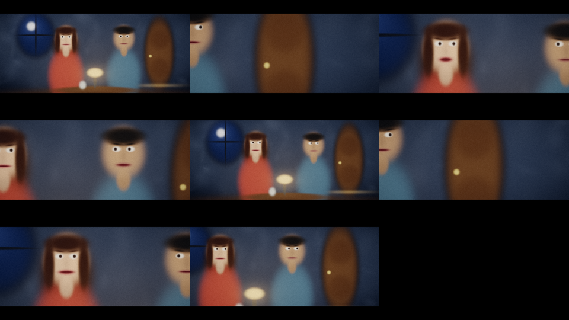
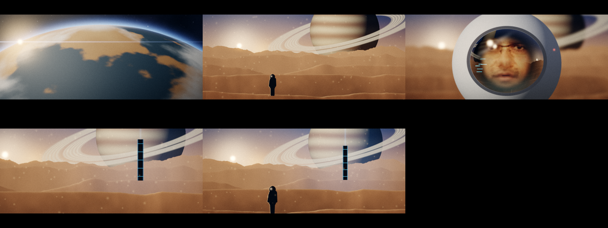

# CINEGEN — filmes e séries gerados sem difusão

**Ideia:** em vez de inventar cada pixel de cada quadro (difusão), o filme é tratado como
**um mundo + atores + câmera + som**. O mundo e o elenco são criados **uma vez** e depois
**renderizados**, o que é barato e consistente. Onde é preciso "humanidade" (textura, movimento,
voz), o sistema **recombina dados humanos reais** em vez de alucinar.



## Destaques

- 🎬 **[`saida/o_monolito.mp4`](saida/o_monolito.mp4): cena completa de 45 s em outro planeta.** Mundo
  procedural, rosto gerado falando no capacete, voz humana recombinada e desenho de som completo.
- 🗣️ [`saida/falante_real.mp4`](saida/falante_real.mp4): rosto de uma pessoa que não existe falando,
  com sincronia de 0 ms.
- 🧪 [`ciencia/CADERNO.md`](ciencia/CADERNO.md): caderno de laboratório com todas as hipóteses,
  métricas, falhas e correções.



## O que tem aqui

| Arquivo | Conteúdo |
|---|---|
| [`docs/HIPOTESES.md`](docs/HIPOTESES.md) | As 10 hipóteses originais (imagem, vídeo, atuação, voz, sons, coerência de série) |
| [`docs/ARQUITETURA.md`](docs/ARQUITETURA.md) | Pipeline completo, tamanho dos modelos, orçamento de tempo para um filme de 100 min, fases |
| [`prototipo/`](prototipo/) | Protótipo de brinquedo, **só CPU** (numpy + ffmpeg), que roda o fluxo de ponta a ponta |
| [`saida/a_porta.mp4`](saida/a_porta.mp4) | Curta de 14 s gerado pelo protótipo, com falas, foley, trilha e look de película |
| [`saida/relatorio.md`](saida/relatorio.md) | Tempos, crítico de sincronia labial e medição do codec generativo |

## As hipóteses em uma linha cada

1. **Cena-programa:** o LLM escreve o plano como código; os pixels saem de um renderizador 3DGS (ms por quadro).
2. **Elenco persistente:** cada ator e cada locação é um arquivo reutilizado na série inteira.
3. **Mosaico de Película:** imagem = retalhos de película real + rede de harmonização de 1 passo.
4. **Codec generativo:** gerar vetores de movimento + resíduos (~100× menos números que pixels).
5. **Articulação única:** a mesma trajetória articulatória gera a voz **e** move a boca (sincronia estrutural).
6. **Foley por física:** o som nasce dos eventos da cena (síntese modal + espacialização pela câmera).
7. **Atuação por recombinação:** motion matching sobre captura de movimento de atores reais.
8. **Memória de série:** "bíblia viva" consultada pelo LLM para manter a continuidade.
9. **Ótica física:** lente + película simuladas sem rede neural.
10. **Direção por crítico:** gera variações baratas e críticos pequenos escolhem.

## Rodar o protótipo

```bash
pip install numpy pillow     # e ter o ffmpeg instalado
cd cinegen/prototipo
python3 gerar.py             # ~1,5 min em CPU → ../saida/a_porta.mp4
```

Para mudar o filme, edite `prototipo/roteiro.py` (falas, batidas na porta, pausas). A decupagem,
a voz, a boca, o som e a mixagem são refeitos automaticamente.

## Resultados do protótipo (CPU, 4 núcleos, sem GPU)

- **Sincronia labial:** atraso medido de **0 ms** nas 3 falas, porque boca e voz vêm do mesmo sinal.
  O crítico detecta o atraso de 208 ms colocado de propósito como controle. Uma das falas tem
  correlação baixa (0,48) e foi marcada para revisão: a energia do áudio é um indicador imperfeito
  da abertura da boca em consoantes nasais e oclusivas.
- **Codec generativo:** no plano com câmera em movimento, os vetores de movimento usam **98× menos
  números** que os pixels e reconstroem o quadro seguinte com PSNR de ~46 dB. Como a cena é simples
  e sintética, em filmagem real esse número será bem menor e vai precisar de resíduos.
- **Velocidade:** ~5 qps renderizando em numpy na CPU. Rasterizadores 3DGS em GPU chegam a 100–300 qps em 1080p.

## Limites

O protótipo é uma **prova de fluxo**, não de qualidade de cinema: os personagens são "bonecos" de
gaussianas 2D e a voz é síntese de formantes (soa robótica). Chegar à qualidade humana exige as
fases 1–5 de [`docs/ARQUITETURA.md`](docs/ARQUITETURA.md): atores 3DGS reais, um vocoder neural
treinado na trajetória articulatória, motion matching e o Mosaico de Película. Treinar isso exige
dados licenciados e GPU. As estimativas de tempo valem para depois do treino.
